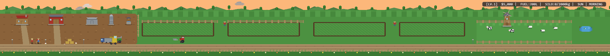

# 🌾 Desktop Idle Farm

**Desktop Idle Farm** — это уютная пиксельная idle-игра про ферму, которая живёт прямо на вашем рабочем столе Windows над панелью задач. 

Ферма развивается полностью автономно: тракторы вспахивают поля, сеялки засевают семена, агрономы инспектируют посадки, комбайны убирают золотой урожай, а грузовики отвозят продукцию на склад и рынок.



---

## ✨ Основные особенности

- 🖥️ **Windows Desktop Integration**:
  - Располагается прямо над панелью задач Windows с учётом масштабирования экрана (DPI) и положения панели задач.
  - Прозрачный фон (`WS_EX_LAYERED`), сквозные клики (`WS_EX_TRANSPARENT`), отсутствие лишних иконок на панели задач (`WS_EX_TOOLWINDOW`).
  - Удерживается на самом нижнем слое рабочего стола (`HWND_BOTTOM`) и автоматически скрывается при открытии полноэкранных игр и приложений.

- 🚜 **Автономная симуляция и ИИ фермы ([farm_ai.py](src/ai/farm_ai.py))**:
  - Приоритетная система заданий для рабочих и техники: починка $\rightarrow$ уборка урожая $\rightarrow$ сев $\rightarrow$ вспашка $\rightarrow$ осмотр посевов $\rightarrow$ доставка.
  - Персонал разных профессий (тракторист, комбайнёр, полевой рабочий, агроном, механик).
  - Техника: малый и средний тракторы с навесными орудиями (плуг, сеялка, прицеп), зерноуборочный комбайн, фермерский грузовик.

- 🌾 **Сельскохозяйственные культуры**:
  - 4 активных поля: пшеница, кукуруза, подсолнухи, ячмень.
  - Полноценные стадии роста: семена $\rightarrow$ ростки $\rightarrow$ побеги $\rightarrow$ созревание $\rightarrow$ сбор урожая $\rightarrow$ стерня.
  - Расчёт урожайности на основе плодородия почвы, влажности, погоды и навыков рабочих.

- 🎨 **Пиксель-арт графика и анимация**:
  - 150+ процедурно сгенерированных пиксельных спрайтов (Pillow).
  - Анимированная ветряная мельница, скорость вращения которой меняется от силы ветра.
  - Животный мир: пёс Рекс, кошка Мурка, куры во дворе, коровы и овцы на огороженном пастбище.
  - Смена времени суток (рассвет, день, вечер, ночь с теплым светом в окнах и фарах техники).
  - Динамическая погода: ясная погода, облачность, дождь, гроза, жара, сильный ветер, град, снег, туман.

- 🔔 **Системный трей ([tray_manager.py](src/tray/tray_manager.py))**:
  - Иконка в трее Windows с меню управления: статистика фермы, хранилище, финансы, найм рабочих, статус техники, пауза и скрытие.

---

## 🚀 Быстрый старт

### Требования
- Windows 10 / 11
- Python 3.10+

### Установка зависимостей
```bash
pip install -r requirements.txt
```

### Запуск игры
```bash
python main.py
```

---

## 🧪 Тестирование

Запуск встроенного набора модульных тестов:
```bash
python -m unittest tests/test_game.py
```

---

## 📁 Структура проекта

```
32bit_idle/
├── assets/                  # Сгенерированные пиксельные спрайты
├── config/                  # Настройки игры (settings.json)
├── localization/            # Локализация (ru, en)
├── logs/                    # Логи работы игры
├── saves/                   # Файлы сохранений
├── src/
│   ├── ai/                  # ИИ фермы и распределение задач
│   ├── core/                # Интеграция с Windows, приложение, константы
│   ├── crops/               # Данные культур и расчет урожайности
│   ├── economy/             # Финансы, склад, рыночные цены
│   ├── entities/            # Рабочие, техника, животные
│   ├── fields/              # Система полей и тайлов
│   ├── rendering/           # Pygame рендерер и генератор спрайтов
│   ├── simulation/          # Движок симуляции и оффлайн-прогресс
│   ├── tray/                # Меню системного трея Windows
│   └── weather/             # Погодная система и частицы
├── tests/                   # Набор unit-тестов
├── main.py                  # Главная точка входа
├── test_visual.py           # Скрипт визуальной верификации
├── requirements.txt         # Зависимости проекта
└── README.md
```

---

## 📜 Лицензия

MIT License
